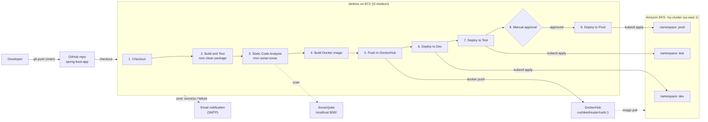
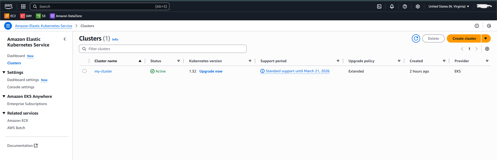
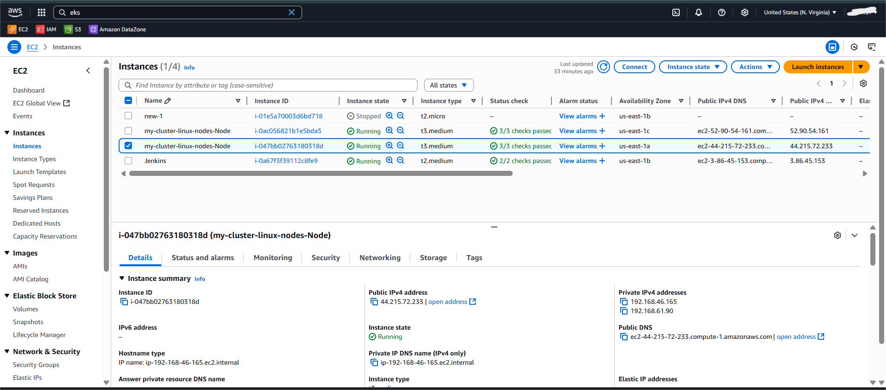
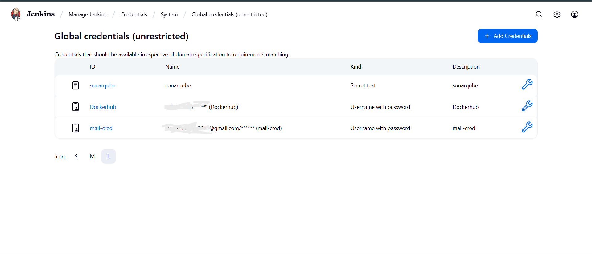
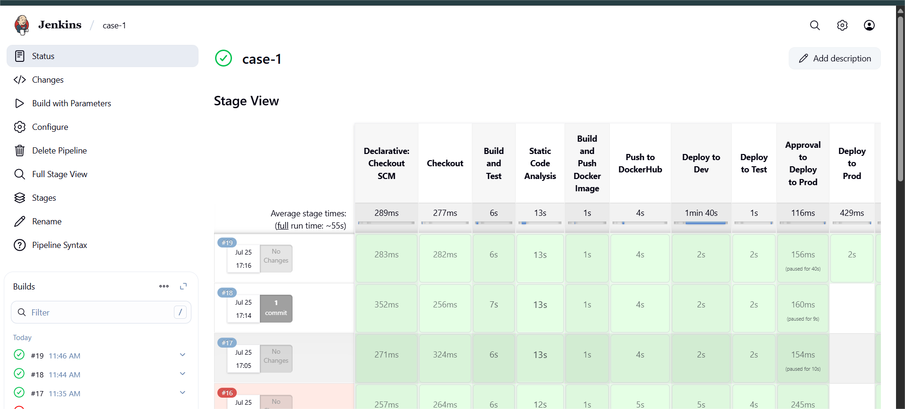
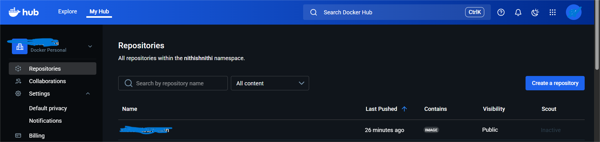
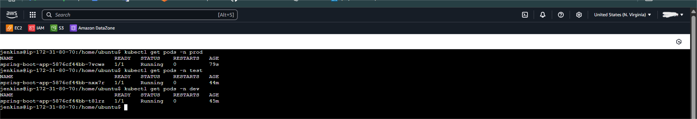
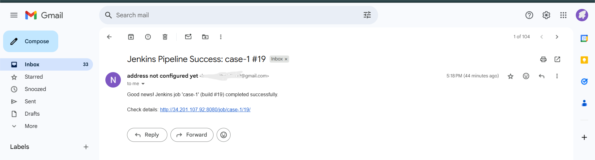

# Jenkins CI/CD Pipeline for Multi-Environment Deployment on Amazon EKS

> A declarative Jenkins pipeline that builds a Spring Boot application with Maven, analyses it with SonarQube, packages it as a Docker image, pushes it to DockerHub, and deploys it to **dev**, **test** and **prod** namespaces on Amazon EKS - with a **manual approval gate before production** and email notifications on success or failure.

**Case Study 1 of 6** in my AWS DevOps portfolio.

---

## Table of Contents

1. [Project Overview](#1-project-overview)
2. [Problem Statement and Objectives](#2-problem-statement-and-objectives)
3. [Requirement Coverage (Honest Scope)](#3-requirement-coverage-honest-scope)
4. [Architecture](#4-architecture)
5. [Technology Stack and Prerequisites](#5-technology-stack-and-prerequisites)
6. [Repository Structure](#6-repository-structure)
7. [Implementation (Phase by Phase)](#7-implementation-phase-by-phase)
8. [Validation and Expected Results](#8-validation-and-expected-results)
9. [Screenshots and Evidence](#9-screenshots-and-evidence)
10. [Troubleshooting](#10-troubleshooting)
11. [Security and Cost Considerations](#11-security-and-cost-considerations)
12. [Cleanup](#12-cleanup)
13. [Lessons Learned](#13-lessons-learned)
14. [Official Documentation References](#14-official-documentation-references)

---

## 1. Project Overview

**Real-world scenario.** A product team ships a Spring Boot web application and commits to it several times a day. Releases used to be manual and inconsistent: someone built the JAR, someone else built the image, and deployments to dev, test and prod were done by hand with `kubectl`. The team needs a repeatable path from commit to running pods, with quality checks along the way and a human sign-off before anything reaches production.

**What this project delivers.**

- One Jenkins declarative pipeline (`jenkins/Jenkinsfile`) that automates build, test, static analysis, containerisation, registry push and Kubernetes deployment.
- Three isolated environments (`dev`, `test`, `prod`) as namespaces in a single EKS cluster (`my-cluster`, `us-east-1`).
- YAML-based deployments (`manifest_file/k8s/<env>/deployment.yaml`) applied with `kubectl apply` and verified with `kubectl rollout status`.
- A manual approval step before the production deployment.
- Email notification (via Jenkins `mail` step) on pipeline success or failure.
- Credentials (SonarQube token, DockerHub login, mail login) held in the Jenkins credential store, never in the repository.

---

## 2. Problem Statement and Objectives

**Problem statement (summary).** Set up a multi-environment, declarative/YAML-based deployment pipeline for a web application on EKS. Containerise the app with Docker, scan for vulnerabilities before pushing to the registry, deploy automatically to dev/qa/prod when the matching branch changes, keep the pipeline fast, require manual approval for prod, run code-coverage and test-coverage stages in parallel, and notify and terminate the pipeline if coverage is below 80% or a critical finding is detected.

The full original text is preserved in [`docs/case-study.md`](docs/case-study.md).

**Objectives.**

| # | Objective |
|---|---|
| 1 | Provision an EKS cluster with isolated `dev`, `test` and `prod` namespaces |
| 2 | Build and unit-test the Spring Boot app with Maven |
| 3 | Run static code analysis with SonarQube |
| 4 | Build a Docker image and push it to DockerHub |
| 5 | Deploy automatically to dev, then test, using Kubernetes YAML manifests |
| 6 | Pause for manual approval before production |
| 7 | Notify by email on success or failure |
| 8 | Keep all secrets out of source control |

---

## 3. Requirement Coverage (Honest Scope)

This table compares the original problem statement with what the submitted pipeline actually does. Gaps are listed deliberately: knowing them (and how to close them) is more valuable in an interview than claiming a perfect solution. Ready-to-use fixes are in [`docs/improvements.md`](docs/improvements.md).

| Requirement from the case study | Status | Notes |
|---|---|---|
| Declarative, YAML-based multi-environment pipeline on EKS | Done | Declarative `Jenkinsfile`; per-environment `deployment.yaml`; namespaces dev/test/prod |
| Containerise with Docker | Done | `docker build -t $IMAGE_NAME .` |
| Manual approval before prod | Done, with a caveat | `input` step is present; see the `params.Proceed` note in [Lessons Learned](#13-lessons-learned) |
| Build management and code quality | Done | Maven build, `mvn sonar:sonar` |
| Notification on failure | Done | `post { failure { mail ... } }` fires on any failed stage |
| Environments dev / qa / prod | Done as dev / test / prod | Naming differs from the statement ("qa" vs "test") |
| Deploy automatically when branch code changes | Partial | Pipeline checks out `main`; no webhook or multibranch trigger in the submitted Jenkinsfile |
| Image vulnerability scan before push | Not in the submitted pipeline | SonarQube analyses source code, not images; add Trivy (see improvements) |
| Test coverage and code coverage stages in parallel | Not in the submitted pipeline | Stages run sequentially; `parallel {}` snippet in improvements |
| Fail and notify if coverage < 80% or a critical issue is found | Partial | Email on any failure, but no explicit 80% gate or `waitForQualityGate`; snippets in improvements |
| Responsive pipeline | Reasonable | Stage View in the screenshots reports a full run time of about 55 seconds |

---

## 4. Architecture



**Flow in one paragraph.** A commit lands on `main`. Jenkins checks out the code, builds and tests it with Maven, sends it to SonarQube, builds the Docker image and pushes it to DockerHub. It then applies the dev manifest and waits for the rollout, does the same for test, and pauses for a human to approve production. After approval it applies the prod manifest. A `post` block emails the result.

---

## 5. Technology Stack and Prerequisites

| Layer | Tool | Role in this project |
|---|---|---|
| CI/CD | Jenkins (declarative pipeline) | Orchestrates every stage; runs on an EC2 `t2.medium` instance |
| Build | Maven, JDK | `mvn clean package` (compile, unit tests, package) |
| Code quality | SonarQube | Static analysis via `mvn sonar:sonar` (reachable at `localhost:9000` from Jenkins) |
| Containers | Docker | Builds the image on the Jenkins host |
| Registry | DockerHub | Stores `rushikeshsutar/rushi:1` |
| Orchestration | Amazon EKS (Kubernetes 1.32 in the screenshot) | Hosts dev/test/prod namespaces |
| Cluster tooling | `eksctl`, `kubectl`, AWS CLI | Create the cluster, configure access, deploy |
| Notification | Jenkins `mail` step over SMTP | Success/failure emails |
| Source control | GitHub | Application repo (`spring-boot-app`) |

**Prerequisites**

- An AWS account with permission to create EKS clusters, EC2 instances, IAM roles and CloudFormation stacks (eksctl uses CloudFormation).
- A Jenkins server on EC2 with: JDK, Maven, Docker, `kubectl`, AWS CLI, and network access to GitHub, DockerHub and the EKS API.
- SonarQube reachable from Jenkins (this lab used `http://localhost:9000` on the Jenkins host).
- A DockerHub account and access token.
- An SMTP-capable mailbox for notifications (a Gmail account with an app password was used here).
- The application repository (`spring-boot-app`) containing a `Dockerfile` in the root and `manifest_file/k8s/<env>/deployment.yaml` files.

Required Jenkins plugins: Pipeline, Git, Credentials Binding, SonarQube Scanner, Mailer.

---

## 6. Repository Structure

```text
jenkins-eks-multi-env-cicd-pipeline/
|-- README.md
|-- .gitignore
|-- jenkins/
|   `-- Jenkinsfile                  # The pipeline, exactly as executed
|-- manifest_file/
|   `-- k8s/                         # Path the Jenkinsfile expects (MANIFEST_PATH)
|       |-- dev/deployment.yaml
|       |-- test/deployment.yaml
|       `-- prod/deployment.yaml
|-- scripts/
|   |-- 01-create-eks-cluster.sh     # eksctl create cluster (asks for confirmation)
|   |-- 02-configure-cluster.sh      # update-kubeconfig + create namespaces
|   |-- 03-verify-deployments.sh     # kubectl checks for dev/test/prod
|   `-- 99-cleanup.sh                # delete workloads and the cluster (asks for confirmation)
|-- docs/
|   |-- case-study.md                # Original problem statement and source discrepancies
|   |-- improvements.md              # Closing the gaps against the problem statement
|   `-- interview-notes.md           # Talking points and Q&A
`-- screenshots/
    |-- 01-eks-cluster-active.png
    |-- 02-ec2-jenkins-and-worker-nodes.png
    |-- 03-jenkins-credentials.png
    |-- 04-jenkins-pipeline-stage-view.png
    |-- 05-dockerhub-image-pushed.png
    |-- 06-kubectl-pods-dev-test-prod.png
    `-- 07-email-notification-success.png
```

> **Note on manifests.** In the original lab the `manifest_file/k8s/` folder lives in the **application** repository, because the pipeline checks that repo out and applies the manifests from it. The copies here are reference manifests reconstructed from the Jenkinsfile and the pod output (one replica, deployment named `spring-boot-app`). The container port `8080` is the Spring Boot default and is an assumption. Replace them with your originals if they differ.

---

## 7. Implementation (Phase by Phase)

### Phase 1 - Create the EKS cluster and namespaces

```bash
# 1. Create the cluster (takes roughly 15-20 minutes; billable)
eksctl create cluster \
  --name my-cluster \
  --region us-east-1 \
  --node-type t2.medium \
  --nodes-min 1 \
  --nodes-max 2

# 2. Point kubectl at the cluster
aws eks update-kubeconfig --region us-east-1 --name my-cluster

# 3. Create one namespace per environment
kubectl create namespace dev
kubectl create namespace test
kubectl create namespace prod
```

The same steps are scripted in `scripts/01-create-eks-cluster.sh` and `scripts/02-configure-cluster.sh`.

> The source answer sheet printed step 2 as `eks update-kubeconfig`; the correct command starts with `aws`. The EC2 console in the screenshots shows `t3.medium` worker nodes, so confirm the node type you actually got.

### Phase 2 - Prepare the Jenkins host

The pipeline runs `mvn`, `docker` and `kubectl` as the `jenkins` OS user, so all three must work for that user.

```bash
# Verify tools exist
java -version && mvn -version && docker --version && kubectl version --client && aws --version

# Allow Jenkins to use Docker, then restart Jenkins
sudo usermod -aG docker jenkins
sudo systemctl restart jenkins

# Give the jenkins user a kubeconfig for the cluster
sudo -u jenkins -H aws eks update-kubeconfig --region us-east-1 --name my-cluster
sudo -u jenkins -H kubectl get nodes
```

If `kubectl get nodes` returns `Unauthorized`, the IAM identity used by Jenkins is not yet authorised in the cluster (see [Security](#11-security-and-cost-considerations)).

Install SonarQube where Jenkins can reach it. One common evaluation setup is a container on the Jenkins host:

```bash
docker run -d --name sonarqube -p 9000:9000 sonarqube:latest
```

Then open `http://<jenkins-host>:9000`, log in, and generate a user token. Use a persistent volume for anything beyond a lab.

### Phase 3 - Configure Jenkins

1. **Plugins:** Manage Jenkins > Plugins > install Pipeline, Git, Credentials Binding, SonarQube Scanner, Mailer.
2. **Credentials:** Manage Jenkins > Credentials > Global. Create exactly the IDs the Jenkinsfile references:

   | ID | Kind | Used by |
   |---|---|---|
   | `sonarqube` | Secret text (SonarQube token) | Static Code Analysis stage |
   | `Dockerhub` | Username with password (DockerHub user + access token) | Push to DockerHub stage |
   | `mail-cred` | Username with password (mailbox login) | SMTP settings for notifications |

3. **Email:** Manage Jenkins > System. Set **System Admin e-mail address** (the sender) and the SMTP server (for Gmail: `smtp.gmail.com`, SSL, port 465, using an app password). Use **Test configuration by sending test e-mail** before relying on it.

### Phase 4 - Prepare the application repository

The application repo (`spring-boot-app`) must contain:

- `Dockerfile` in the repository root (the pipeline runs `docker build -t $IMAGE_NAME .`)
- `manifest_file/k8s/dev/deployment.yaml`, `.../test/deployment.yaml`, `.../prod/deployment.yaml`
- a Deployment named `spring-boot-app` in each manifest (the pipeline waits on `deployment/spring-boot-app`)

Do not hard-code `metadata.namespace` in the manifests unless it matches the `--namespace` flag; a mismatch makes `kubectl apply` fail.

### Phase 5 - Create the pipeline job

1. Jenkins > New Item > name it `case-1` > **Pipeline**.
2. Under Pipeline, choose **Pipeline script** and paste `jenkins/Jenkinsfile` (or **Pipeline script from SCM** and point at a repo containing it).
3. Save. Because the Jenkinsfile declares a `Proceed` boolean parameter, the job shows **Build with Parameters**.

The pipeline definition (full file in `jenkins/Jenkinsfile`):

```groovy
pipeline {
  agent any
  environment {
    IMAGE_NAME    = "rushikeshsutar/rushi:1"
    MANIFEST_PATH = "manifest_file/k8s"
  }
  parameters {
    booleanParam(name: 'Proceed', defaultValue: false, description: 'Approve the deployment to Prod')
  }
  stages {
    stage('Checkout')                 { /* git branch: 'main', url: '.../spring-boot-app.git' */ }
    stage('Build and Test')           { /* mvn clean package */ }
    stage('Static Code Analysis')     { /* mvn sonar:sonar with SONAR_AUTH_TOKEN */ }
    stage('Build a Docker Image')     { /* docker build -t $IMAGE_NAME . */ }
    stage('Push to DockerHub')        { /* docker login --password-stdin; docker push */ }
    stage('Deploy to Dev')            { /* kubectl apply ... --namespace=dev; rollout status */ }
    stage('Deploy to Test')           { /* kubectl apply ... --namespace=test; rollout status */ }
    stage('Approval to Deploy to Prod') { /* input message: "Approve deployment to Prod?" */ }
    stage('Deploy to Prod')           { /* when params.Proceed; kubectl apply ... --namespace=prod */ }
  }
  post {
    success { /* mail: Jenkins Pipeline Success */ }
    failure { /* mail: Jenkins Pipeline Failure */ }
  }
}
```

### Phase 6 - Run the pipeline

1. Click **Build with Parameters**.
2. Tick **Proceed** if you intend to deploy to production on this run.
3. Watch Stage View. Dev and Test deploy automatically.
4. At **Approval to Deploy to Prod**, open the running build and click **Proceed** on the input prompt.
5. Prod deploys, then the success email is sent.

### Phase 7 - Verify

```bash
./scripts/03-verify-deployments.sh
```

or manually, see the next section.

---

## 8. Validation and Expected Results

| Check | Command | Expected result |
|---|---|---|
| Cluster is active | `aws eks describe-cluster --name my-cluster --region us-east-1 --query cluster.status` | `"ACTIVE"` |
| Nodes are ready | `kubectl get nodes` | 1-2 nodes in `Ready` state |
| Namespaces exist | `kubectl get namespaces` | `dev`, `test`, `prod` listed |
| Dev pod | `kubectl get pods -n dev` | `spring-boot-app-...` `1/1 Running` |
| Test pod | `kubectl get pods -n test` | `spring-boot-app-...` `1/1 Running` |
| Prod pod | `kubectl get pods -n prod` | `spring-boot-app-...` `1/1 Running` |
| Rollout finished | `kubectl rollout status deployment/spring-boot-app -n prod` | `successfully rolled out` |
| Image in registry | DockerHub repository page | `rushikeshsutar/rushi` shows a recent push |
| Notification | Mailbox | "Jenkins Pipeline Success: case-1 #<n>" |

Output observed in my run:

```text
$ kubectl get pods -n prod
NAME                              READY   STATUS    RESTARTS   AGE
spring-boot-app-5876cf44bb-7vcws  1/1     Running   0          79s
$ kubectl get pods -n test
spring-boot-app-5876cf44bb-nxx7r  1/1     Running   0          44m
$ kubectl get pods -n dev
spring-boot-app-5876cf44bb-t8lrz  1/1     Running   0          45m
```

Prod is the youngest pod, which matches the order of the pipeline: dev and test deployed first, prod only after approval.

---

## 9. Screenshots and Evidence

> Before publishing, blur account names, IP addresses, instance IDs and email addresses in these images.

| # | Evidence | Screenshot |
|---|---|---|
| 1 | EKS cluster `my-cluster` is **Active** (Kubernetes 1.32, us-east-1) |  |
| 2 | EC2 console: the Jenkins server plus two EKS worker nodes in different availability zones |  |
| 3 | Jenkins credentials: `sonarqube` (secret text), `Dockerhub` and `mail-cred` (username/password), all masked |  |
| 4 | Jenkins Stage View for job `case-1`, builds #16-#19, all stages including the approval pause |  |
| 5 | DockerHub repository `rushikeshsutar/rushi` with a fresh image push |  |
| 6 | `kubectl get pods` in `prod`, `test` and `dev`: one running pod each |  |
| 7 | Success email for build #19 |  |

What the Stage View shows: build #19 passed every stage including **Deploy to Prod**, while builds #17 and #18 show an empty Deploy to Prod cell, consistent with the `when { params.Proceed }` condition skipping production when the parameter was not ticked.

---

## 10. Troubleshooting

| Symptom | Likely cause | Fix |
|---|---|---|
| `permission denied ... /var/run/docker.sock` during Docker stages | `jenkins` user is not in the `docker` group | `sudo usermod -aG docker jenkins && sudo systemctl restart jenkins` |
| `error: You must be logged in to the server (Unauthorized)` | No kubeconfig for the `jenkins` user, or its IAM identity is not authorised in the cluster | Run `aws eks update-kubeconfig` as `jenkins`; add an EKS access entry for that IAM principal |
| `the namespace from the provided object does not match the namespace "dev"` | `metadata.namespace` in the manifest differs from `--namespace` | Remove it from the manifest or make them identical |
| SonarQube stage: `Connection refused` on `localhost:9000` | SonarQube is not running, or runs on a different host than the Jenkins agent | Start the container; set `SONAR_URL` to an address the agent can reach |
| SonarQube: `Not authorized` | Expired or wrong token; `sonar.login` is deprecated on newer SonarQube versions | Regenerate the token, update the `sonarqube` credential, use `-Dsonar.token` if your version requires it |
| `ImagePullBackOff` on the pod | Image or tag was not pushed, or the repo is private | Check DockerHub for the tag; make the repo public or add an `imagePullSecret` |
| A re-run deploys but nothing changes | The tag is always `:1`, so the pod spec is unchanged and `kubectl apply` is a no-op | Tag with `${BUILD_NUMBER}` or run `kubectl rollout restart deployment/spring-boot-app -n <env>` |
| `rollout status` waits then times out | Pod `Pending` (insufficient CPU/memory on small nodes) or crash-looping | `kubectl describe pod` and `kubectl logs` in the namespace |
| Prod stage skipped even though you clicked Proceed on the prompt | `params.Proceed` is the **build parameter**, not the answer to the `input` prompt | Tick **Proceed** in Build with Parameters, or remove the `when` clause (see improvements) |
| Email shows sender "address not configured yet", or no email arrives | Jenkins System Admin e-mail address and SMTP are not fully configured | Manage Jenkins > System: set the admin address and SMTP, then send a test email |

---

## 11. Security and Cost Considerations

**Security**

- **Secrets:** SonarQube token, DockerHub login and mail login live in the Jenkins credential store and are injected with `withCredentials`, so they are masked in logs. Docker login uses `--password-stdin` so the secret never appears on a command line.
- **Never commit** kubeconfig files, `.pem` keys or tokens (`.gitignore` already excludes common ones).
- **Least privilege for deploys:** instead of cluster-admin, give the Jenkins IAM principal an EKS access entry scoped to the three namespaces:

  ```bash
  aws eks create-access-entry --cluster-name my-cluster --principal-arn <JENKINS_IAM_ARN>
  aws eks associate-access-policy --cluster-name my-cluster \
    --principal-arn <JENKINS_IAM_ARN> \
    --policy-arn arn:aws:eks::aws:cluster-access-policy/AmazonEKSEditPolicy \
    --access-scope type=namespace,namespaces=dev,test,prod
  ```
- **Production gate:** restrict who can approve with the `submitter` option of `input`, and add a `timeout` so stale approvals expire.
- **Network exposure:** restrict the Jenkins security group (port 8080) to trusted IPs, front it with HTTPS, and keep SonarQube off the public internet.
- **Supply chain:** the submitted pipeline has no image scan and uses a mutable tag. Add Trivy and unique tags (see improvements); consider a private registry such as Amazon ECR for proprietary images.
- **Hard-coded values:** the notification address and image name are hard-coded in the Jenkinsfile. Parameterise them before publishing a template for others.
- **Screenshots:** redact account names, IPs, instance IDs and email addresses before pushing to a public repository.

**Cost**

- The EKS control plane is billed per hour while the cluster exists, even when idle; check the current rate on the EKS pricing page.
- Worker nodes (EC2), the Jenkins EC2 instance and attached EBS volumes are billed separately. The screenshot shows two worker nodes plus Jenkins running.
- The screenshot shows Kubernetes 1.32 with an *Extended* upgrade policy. Versions past standard support can incur extra control-plane charges, so check the support dates when you create a cluster.
- Delete the cluster as soon as the lab is complete, and set an AWS Budgets alert.

---

## 12. Cleanup

Do this as soon as you finish, to stop charges.

```bash
# Option A: guided script (asks you to type the cluster name)
./scripts/99-cleanup.sh

# Option B: manual
kubectl delete deployment spring-boot-app -n dev
kubectl delete deployment spring-boot-app -n test
kubectl delete deployment spring-boot-app -n prod
eksctl delete cluster --name my-cluster --region us-east-1 --wait
```

Then, outside the cluster:

1. Stop or terminate the Jenkins EC2 instance (and its EBS volume if terminated).
2. Check **CloudFormation** for leftover `eksctl-my-cluster-*` stacks, and **EC2 > Load Balancers / Volumes / Elastic IPs** for orphans.
3. Optionally delete the DockerHub repository and revoke the DockerHub, SonarQube and mail tokens.
4. Remove the Jenkins credentials created for this lab.

---

## 13. Lessons Learned

- **Read the requirements against the result.** The submitted pipeline covers the delivery and approval flow well, but the problem statement also asked for image scanning, parallel coverage stages and an 80% gate. Mapping each requirement to evidence (section 3) exposed the gaps.
- **`input` and `params` are different things.** The `input` step's parameter does not populate `params.Proceed`. In this Jenkinsfile, production runs only if **Proceed** was ticked when the build started *and* the input prompt was approved. A cleaner design is an `input` step with no `when` clause, or one that uses the value `input` returns.
- **Mutable tags hide deployments.** Pushing `:1` repeatedly means `kubectl apply` sees no change. Tag every build uniquely.
- **Static analysis is not image scanning.** SonarQube inspects source; vulnerability scanning of the image needs a tool such as Trivy.
- **A pipeline can only fail the build if the gate is wired in.** Running `sonar:sonar` alone does not stop the pipeline on a failed quality gate; `waitForQualityGate abortPipeline: true` does.
- **Every host-level dependency matters.** Docker group membership, a kubeconfig for the `jenkins` user, and the SMTP sender address were the real blockers, not the Groovy.
- **Documentation drifts.** The answer sheet, Jenkinsfile and console disagreed in several places (see `docs/case-study.md`); the executed artefacts should be the source of truth.

---

## 14. Official Documentation References

- Amazon EKS user guide - https://docs.aws.amazon.com/eks/latest/userguide/
- Getting started with EKS using eksctl - https://docs.aws.amazon.com/eks/latest/userguide/getting-started-eksctl.html
- Create or update a kubeconfig for EKS - https://docs.aws.amazon.com/eks/latest/userguide/create-kubeconfig.html
- Amazon EKS pricing - https://aws.amazon.com/eks/pricing/
- eksctl - https://eksctl.io/
- Jenkins Pipeline - https://www.jenkins.io/doc/book/pipeline/
- Jenkins Pipeline syntax (`input`, `when`, `post`, `parallel`) - https://www.jenkins.io/doc/book/pipeline/syntax/
- Jenkins SonarQube Scanner plugin - https://plugins.jenkins.io/sonar/
- Jenkins Mailer plugin - https://plugins.jenkins.io/mailer/
- SonarQube documentation - https://docs.sonarsource.com/
- Kubernetes Deployments - https://kubernetes.io/docs/concepts/workloads/controllers/deployment/
- kubectl reference - https://kubernetes.io/docs/reference/kubectl/
- Docker CLI `docker image push` - https://docs.docker.com/reference/cli/docker/image/push/
- Trivy (container image scanning, used in the improvements) - https://trivy.dev/
